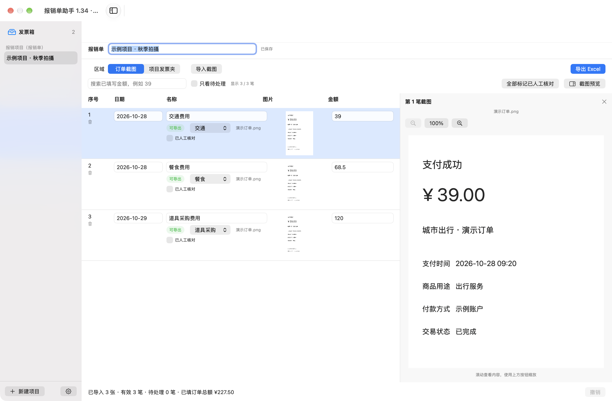
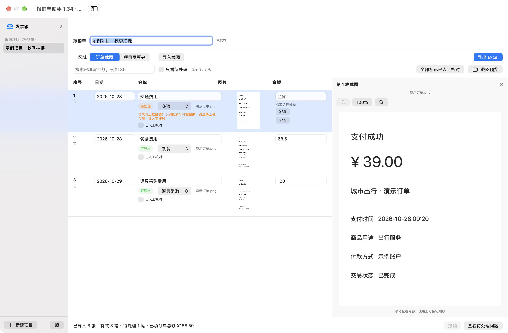
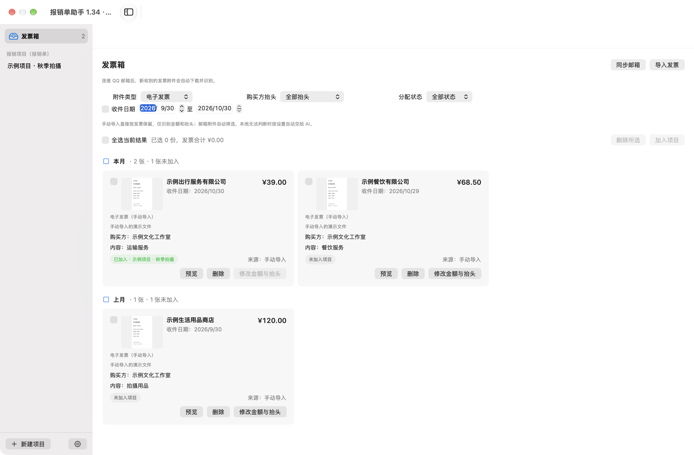
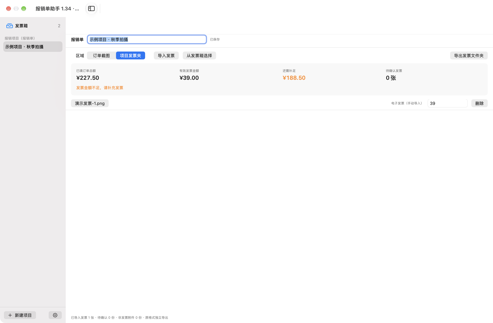
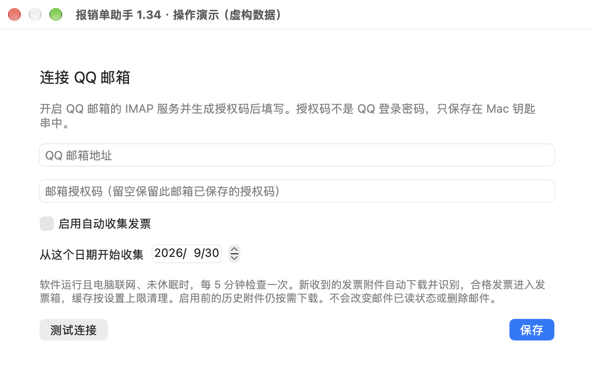
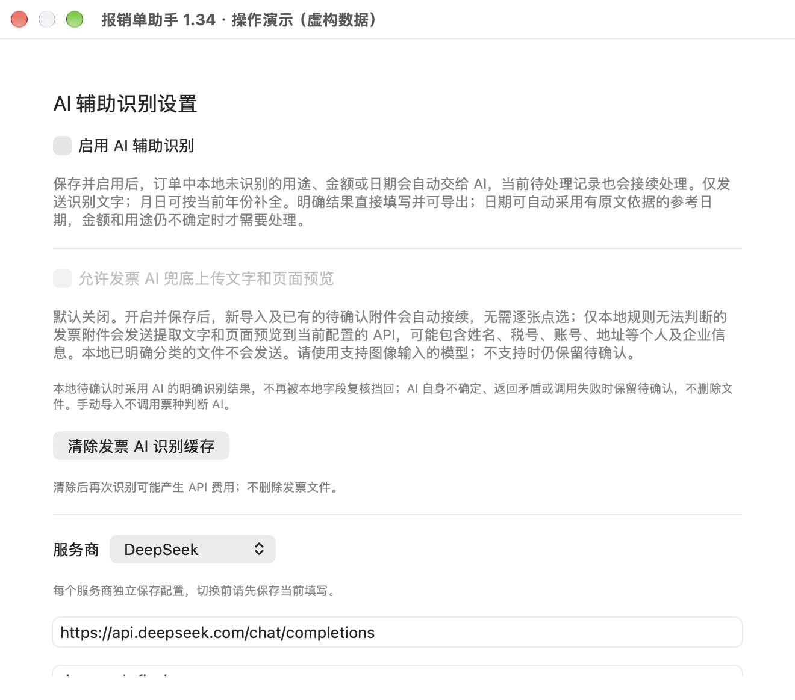
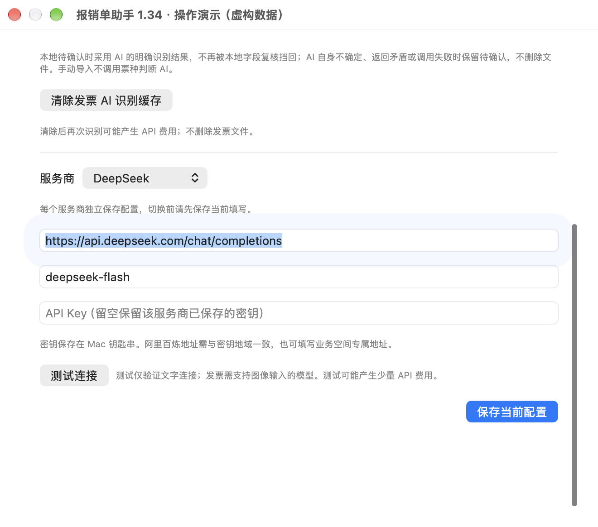
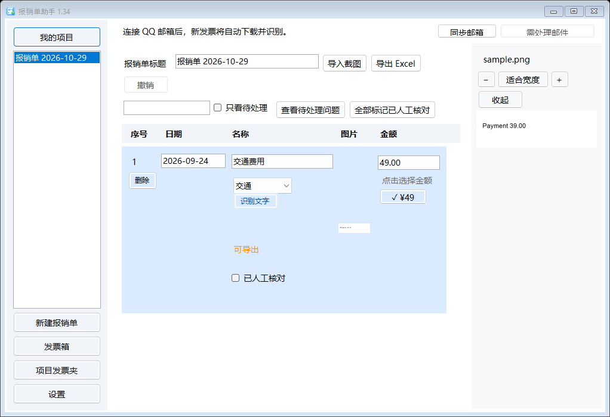

# 报销单助手

**把订单截图整理成 Excel，把发票集中收好，再分给对应的报销项目。**

导入截图后，软件会尝试填写日期、用途和金额。你可以修改结果、拖动排序，再导出一份可用 **WPS 打开、检查和打印**的报销单。

不连接邮箱、不配置 AI，也可以使用。

*Mac 1.34 界面。本文截图均使用虚构数据演示，不是真实订单或发票。Windows 的主要功能相同，按钮位置略有不同。点击图片可查看大图。*

## 下载与安装

| 你的电脑 | 下载 | 怎么安装 |
| --- | --- | --- |
| Apple 芯片 Mac，macOS 15 或更新版本 | [下载 Mac 1.34（DMG）](https://github.com/CHANGEYOOO/reimbursement-assistant/releases/download/v1.34.0/ReimbursementAssistant-macOS-1.34.dmg) | 打开 DMG，将软件拖入“应用程序” |
| 64 位 Windows，推荐 Windows 11 | [下载 Windows 1.34（EXE）](https://github.com/CHANGEYOOO/reimbursement-assistant/releases/download/v1.34.0/ReimbursementAssistant-Windows-1.34-Setup.exe) | 运行 EXE，按中文提示安装 |

[查看更新说明与全部下载文件](https://github.com/CHANGEYOOO/reimbursement-assistant/releases/tag/v1.34.0)

Mac 首次打开若提示“Apple 无法验证”，确认来自本仓库后，可到“系统设置 → 隐私与安全性”选择“仍要打开”。Windows 安装包未商业签名，首次运行可能出现信誉提示。

## 第一次使用：做一份报销单

### ① 新建项目，导入截图

Mac 点击左下角 **“新建项目”**；Windows 点击左侧 **“新建报销单”**。填写项目标题，例如“秋季拍摄”。

点击 **“导入截图”**，一次选择多张 JPG、PNG 或 HEIC 图片。也可以从文件夹拖入，之后还能继续追加。

上方第一张图可以这样看：

| 界面位置 | 用来做什么 |
| --- | --- |
| 左侧项目列表 | 切换不同的报销项目 |
| 中间订单列表 | 修改日期、用途、分类和金额 |
| 右侧截图预览 | 对照原图检查，可缩放、收起 |
| 上方“导出 Excel” | 完成后生成报销单 |

### ② 核对日期、用途和金额

软件会尝试自动填写这些内容，你也可以直接修改。

- **日期：**输入 `20260924`，会边输入边补成 `2026-09-24`。
- **用途：**选择“交通”“餐食”“住宿”“道具采购”等分类。用途为空或仍为默认名称时，会自动填写对应费用名称；自定义用途保留。
- **金额：**看不准时对照右侧原图修改。截图中的负数扣款会按正数支出填写。
- **顺序：**按住订单行拖动；选中的行会高亮。
- **导错了：**删除对应订单即可。

### ③ 有多个金额时，点击正确候选

**先看原图，再点击金额栏下方的正确数字。** 如果候选里没有正确金额，直接在金额输入框填写。

订单很多时，可以：

- 勾选 **“只看待处理”**，集中处理有问题的订单。
- 点击 **“查看待处理问题”**，跳到第一笔需要处理的记录。
- 在金额搜索框输入 `39`，查找金额包含 `39` 的订单，例如 `39.00`、`139.50`。

搜索和筛选只改变当前显示，导出仍包含完整报销单。**“全部标记已人工核对”不会补齐缺失的日期、金额或用途。**

### ④ 导出 Excel

检查完成后，点击 **“导出 Excel”**，选择保存位置，再用 WPS 打开。

导出的栏目依次为：**序号 → 日期 → 名称 → 图片 → 金额**，末尾附有合计。还有未处理问题时，软件会提示你补齐。

项目会自动保存在当前电脑，下次打开可以继续编辑。自动保存不是云端备份，重要项目请另行备份。

## 还需要交发票？按这条流程操作

**发票箱收集全部发票 → 勾选加入项目 → 检查是否足额 → 单独导出发票文件夹。**

发票不必逐条对应订单截图，只需按你的报销要求补足总金额。

### ① 在发票箱收集发票

点击左侧 **“发票箱”**，手动导入 PDF、图片、OFD、XML 或 ZIP；也可以连接 QQ 邮箱自动收票。

- 按月份从新到旧查看；邮箱发票使用**收到邮件的日期**，手动导入使用导入日期。
- 按购买方抬头、日期或是否已加入项目筛选。
- 勾选要使用的发票，再点 **“加入项目”**；已加入的发票会显示对应项目。
- 点击“本月”等月份标题，可批量选择当前筛选下尚未加入项目的合格发票。

**手动导入视为你已确认是发票**，只提取金额和抬头。邮箱附件会自动区分电子发票、非发票附件和待确认文件；无法判断的文件不会自动删除。

### ② 在项目发票夹检查并导出

Mac 在项目顶部切换到 **“项目发票夹”**；Windows 点击左侧 **“项目发票夹”**。

检查订单总额、发票总额和差额，补足后点击 **“导出发票文件夹”**。发票保留原格式，**不会放进 Excel**。

文件夹名称例如 `2026-10-30-1280.50`，表示“导出日期-发票总金额”。重复导出不会覆盖已有文件夹。

[查看完整的发票、邮箱与缓存图文指南 →](docs/发票箱使用说明.md)

## 可选：连接 QQ 邮箱自动收票

Mac 点击左下角齿轮；Windows 点击左侧 **“设置”**，再进入 **“QQ 邮箱”**。

1. 在 QQ 邮箱中开启 IMAP，并取得**授权码**。它不是 QQ 登录密码。
2. 在软件中填写邮箱、授权码和开始收集日期。
3. 测试连接，保存并启用。

开始同步后新收到的发票附件会自动下载识别，历史附件按需下载。只有下载链接的邮件，需要到邮箱下载后手动导入。软件不会改变邮件已读状态或删除邮件。

需要后台提醒时，在设置中开启通知或登录启动。Mac 通过顶部菜单栏图标管理后台运行，Windows 通过右下角托盘；从那里选择“退出”才会停止。电脑需联网且未休眠，默认每 5 分钟检查一次。

## 可选：用 AI 帮忙判断复杂订单

在 **“设置 → AI 辅助识别”** 中选择服务商，填写接口地址、模型名称和 API Key，测试连接后保存并启用。

| 场景 | 开启后会怎样 |
| --- | --- |
| 订单金额、日期或用途本地无法确定 | 自动发送识别文字给 AI；明确结果直接填写，手动修改的字段保留 |
| 邮箱附件本地无法判断是否为发票 | 还需单独允许“发票 AI 兜底上传文字和页面预览”；授权默认关闭，需使用支持图片的模型 |

发票 AI 明确判断后会采用其结果；AI 不确定、返回矛盾或调用失败时仍保留待确认。识别结果会缓存，避免同一文件重复请求；清除 AI 缓存后再次识别可能收费。

**隐私提示：**普通文字识别在本地完成。订单 AI 发送识别文字；单独授权的发票 AI 会发送文字和页面图片，可能包含姓名、税号等信息。Mac 密钥保存在钥匙串，Windows 使用当前用户的系统加密保存。AI 服务可能收费，请按需开启。

## Windows 界面参考

*Windows 1.34 实际运行截图，使用虚构测试数据。两端本地 OCR 引擎不同，个别截图识别结果可能不同；Windows 邮件正文以纯文本显示。*

## 常见问题

**一定要买 AI 或连接邮箱吗？** 不需要。导入、编辑、保存和导出都能单独使用。

**所有订单都要勾人工核对吗？** 不需要。显示“可导出”且没有其他问题的订单可以直接导出；缺少日期、金额或用途的记录仍需补齐。

**缓存满了怎么办？** 在“设置 → 缓存管理”调整上限或手动清理。默认 200 MB，可自行修改；只清理可重新下载的邮箱缓存，保留记录、项目副本、手动导入与已导出文件。

**识别不对怎么办？** 日期、用途和金额都可以手动修改；提交前请对照截图检查金额和合计。

**遇到问题怎么反馈？** 到 [GitHub 问题反馈](https://github.com/CHANGEYOOO/reimbursement-assistant/issues)，写明版本、操作步骤和报错。附图前请遮挡姓名、账号等个人信息。
